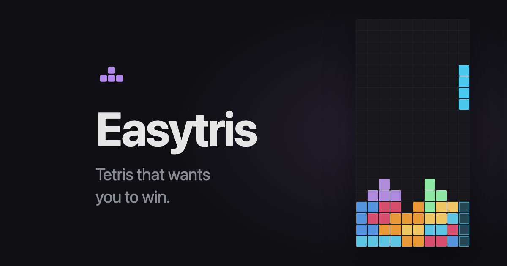

# Easytris

Relaxed Tetris-like game for desktop and mobile.

**[Play it](https://medv.io/easytris/)**

No score, no next-piece preview. The main idea is that pieces are not really random.

The game looks at your board and tries to figure out what piece would be useful next. If you made a gap, it tries to
help you fill it. If you're building a well for an I-piece, it tries to notice that too.

It doesn't always give you the perfect piece, otherwise the game would play itself. It just makes good pieces more
likely.

## How it works

When a new piece is needed:

1. Look at the board: heights, holes, wells, uneven areas.
2. Figure out what is going on: are we in trouble, building something, digging, or just playing normally?
3. Try all seven pieces in different positions.
4. See which pieces leave the board in a better state.
5. Prefer pieces that are useful in several places, not only in one perfect position.
6. Pick one using weighted randomness.

There are no special rules like "this shape needs a J". We just score the resulting board and try to give the player
something useful.

## Controls

| Keyboard                    | Action                   |
| --------------------------- | ------------------------ |
| <kbd>←</kbd> <kbd>→</kbd>   | Move                     |
| <kbd>↓</kbd>                | Soft drop                |
| <kbd>↑</kbd> <kbd>X</kbd>   | Rotate clockwise         |
| <kbd>Z</kbd>                | Rotate counter-clockwise |
| <kbd>Space</kbd>            | Hard drop                |
| <kbd>P</kbd> <kbd>Esc</kbd> | Pause                    |
| <kbd>Enter</kbd>            | Start, resume, restart   |

On a touch screen: drag to move, tap to rotate, flick down to hard drop.

## License

[GNU GPLv3](./LICENSE)

Copyright (C) 2026 Anton Medvedev
